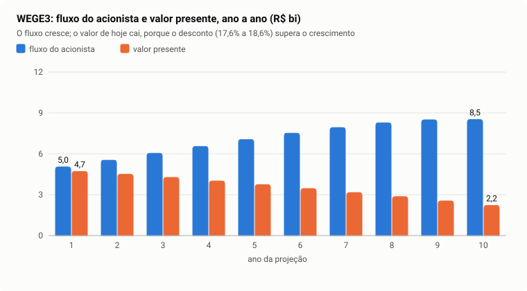
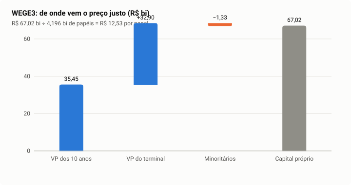

# Caso WEGE3 — WEG, via da firma, do início ao fim

> **O que este caso mostra.** Uma empresa industrial, com mais caixa que dívida,
> retorno sobre o capital muito alto e crescimento consistente. É o caminho
> completo da **via da firma**, com vantagem competitiva residual na
> perpetuidade. Cada passo abaixo é um passo do painel de logs do aplicativo, na
> mesma ordem, com a conta refeita e o porquê.
>
> **Data da avaliação:** 14/09/2026, sobre a entrada congelada do gabarito, com
> o motor de 03/11/2026 (os dados estão em [dados/WEGE3.json](dados/WEGE3.json),
> gerados por `npm run tool -- study-cases`).
>
> **Resultado:** preço justo **R$ 15,97**, contra preço de mercado de
> R$ 50,74 — upside de **−68,5%**. A seção 14 explica por que a distância é tão
> grande.

---

## 1. Os dados de partida

| Grandeza (2026 anualizado) | Valor | De onde vem |
|---|---:|---|
| Receita líquida | R$ 39,22 bi | DRE (CVM) |
| EBIT | R$ 7,61 bi | DRE |
| Lucro líquido | R$ 6,45 bi | DRE |
| Alíquota efetiva do período | 16,7% | imposto ÷ lucro antes do imposto |
| Dívida bruta | R$ 5,07 bi | balanço |
| Caixa e aplicações | R$ 8,80 bi | balanço |
| **Dívida líquida** | **−R$ 3,73 bi** | caixa maior que a dívida |
| Patrimônio líquido | R$ 20,19 bi | VPA × ações do exercício |
| Minoritários | R$ 1,33 bi | balanço |
| Preço de mercado | R$ 50,74 | fechamento de 14/09/2026 |
| Exercícios publicados | 17 (2010–2026) | CVM |

**O último ponto é 2026 anualizado**: o acumulado do primeiro
semestre, no ITR de 30/06/2026, vezes 2, com o balanço da mesma data. A conta
supõe que o segundo semestre repete o primeiro, sem correção de sazonalidade, e
multiplica junto o que for não recorrente; a tela declara isso num aviso. Na
WEG o efeito é pequeno: o EBIT anualizado (R$ 7,61 bi) fica 4,8% abaixo do de
2025 (R$ 8,00 bi).

O motor usa os 17 pontos para medir ciclo, tendência e crescimento, e o último
para a base.

---

## 2. Quantas ações contam (papel negociado e contagem)

**Razão da unit.** O motor confere se WEGE3 é um "pacote" de ações:
`4.197.317.998 ações × R$ 50,74 ÷ R$ 202,98 bi de valor de mercado = 1,049`,
que arredonda para **1**: cada papel é uma ação.

**Contagem da ponte.** Três contagens disponíveis:

| Fonte | Papéis |
|---|---:|
| valor de mercado ÷ preço | 4.000.439.464 |
| demonstrações | 4.197.318.000 |
| **registro oficial da B3, sem tesouraria** | **4.195.829.691** |

As duas da fonte concordam (diferença de 4,9%, dentro da banda de 1,5×), e o
registro oficial da B3 de 14/09/2026 é adotado, porque ele desconta as ações em
tesouraria, que não recebem nada.

> **Por quê:** o preço justo é "capital próprio ÷ papéis". Dividir pelo número
> errado erra o preço na mesma proporção.

---

## 3. Qual caminho (Portas 0, 1 e 3)

- **Porta 0:** liquidez, histórico (17 pontos) e patrimônio positivo — passa.
- **Porta 1:** setor "bens industriais" — não é financeira.
- **Porta 3:** NOPAT positivo em pelo menos 60% dos exercícios — **via da
  firma**.

---

## 4. O custo do capital próprio de hoje (CAPM)

```
Ke = Rf + β × prêmio = 14,05% + 0,7139 × 1,21% = 14,05% + 0,86% = 14,91%
```

- **Rf = 14,05%**: o CDI dos últimos 63 pregões, anualizado.
- **β = 0,7139**: regressão de cinco anos de retornos diários da WEG contra o
  Ibovespa, com 32 proventos reinvestidos, encolhida para o setor (a medida é
  precisa e o peso dela é quase 1). A WEG oscila menos que o mercado.
- **Prêmio = 1,21%**: a média de dez anos do prêmio implícito no preço da bolsa
  (capítulo 3, seção 3.7).

Este Ke de 14,91% é o "do dia": o da tela de metas e o do WACC estático. O
desconto de cada ano usa o forward daquele ano (seção 8).

> **Teoria:** CAPM (Sharpe, 1964). Capítulo 3, seção 3.8.

---

## 5. O lucro de partida (normalização pelo ciclo)

**Alíquota estrutural.** A mediana das alíquotas efetivas dos 17 pontos é
**16,47%** — a WEG paga menos que 34% por incentivos e juros sobre capital
próprio, e isso é regime, não acaso.

**NOPAT de 2026 anualizado:**

```
NOPAT = EBIT × (1 − 16,47%) = 7.610,8 × 0,8353 = R$ 6.357,0 mi
```

(no ponto anualizado a fonte não traz resultado de coligadas, e o NOPAT é só o
EBIT depois do imposto; capítulo 2, seção 2.4).

**Retorno do último ponto × ciclo:**

```
ROIC 2026 = NOPAT 2026 ÷ capital investido 2025 = 6.357,0 ÷ 15.864,3 = 40,07%
ROIC do ciclo = mediana dos oito exercícios anteriores (2018–2025) = 34,61%
```

Os oito retornos do ciclo, em ordem: 19,1%, 19,9%, 30,1%, 33,5%, 35,7%, 38,0%,
39,3% e 47,2%. Com oito valores, a mediana é a média dos dois do meio:
`(33,53% + 35,68%) ÷ 2 = 34,61%`.

**As três guardas:**

| Guarda | Resultado | Leitura |
|---|---|---|
| 1 — tendência | inclinação de +2,00 p.p./ano, `t` de Newey-West = 7,02 | **domina**: o retorno sobe de forma clara há anos |
| 2 — capital externo | Φ = 0 | crescimento orgânico, base comparável |
| 3 — desvio | último ÷ típico = 1,158, a 0,8 desvio robusto | o último ponto não destoa |

**Conclusão: base mantida** (fator 1,0). O último ponto não é um acidente: é o
patamar atual de uma empresa cujo retorno vem subindo.

> Um detalhe do painel: "queda no triênio (%) −9,97" quer dizer que o lucro
> **subiu** 9,97% em três anos (queda negativa), de R$ 5,87 bi em 2023 para
> R$ 6,45 bi em 2026 anualizado. A trava de saúde só age com queda acima de 50%.

> **Teoria:** normalização pelo ciclo (Damodaran, "normalized earnings");
> regressão com erro de Newey-West (capítulo 6, seção 6.5).

---

## 6. Quanto cresce

```
g pela mediana das variações do capital investido  = 10,84% a.a.
g pela regressão do logaritmo do capital            = 11,43% a.a.
erro-padrão de g                                    = 0,70 p.p.
discordância = |10,84 − 11,43| ÷ 0,70 = 0,85  (crítico 1,76)
```

O erro é pequeno (menos de 3 pontos) e as duas medidas concordam: **crescimento
identificado, g = 10,84%**. A retenção observada no passado (55,6%) é
compatível: com ROIC de 40%, crescer 10,8% exige reter 27%.

> **Teoria:** `g = b × ROIC` (McKinsey, *Valuation*). Capítulo 4, seção 4.5.

---

## 7. O WACC de hoje

| Peça | Valor |
|---|---:|
| E (papéis × preço) | R$ 212,90 bi |
| Dívida bruta | R$ 5,07 bi |
| Caixa | R$ 8,80 bi |
| E + dívida líquida | R$ 209,16 bi |
| Kd = Rf + prêmio (alavancagem −0,43×: caixa líquido → 1,0%) | 15,05% |

```
peso do capital próprio = 212,90 ÷ 209,16 = 1,0179
peso da dívida bruta    = 5,07 ÷ 209,16   = 0,0242
peso do caixa           = 8,80 ÷ 209,16   = 0,0421

WACC = 1,0179 × 14,91% + 0,0242 × 15,05% × (1 − 34%) − 0,0421 × 14,05% × (1 − 34%)
     = 15,18% + 0,24% − 0,39% = 15,03%
```

O peso do capital próprio passa de 100% porque a WEG tem **caixa líquido**: o
caixa rende só a taxa livre de risco (depois do imposto), menos que o Ke, e
puxa a média para cima. O WACC fica **acima** do Ke — o aviso da tela diz isso.

No ponto anualizado de 2026 a despesa financeira não está publicada, então a
cobertura de juros não é medível e o prêmio de crédito sai só da alavancagem; a
tela declara isso num aviso. Mesmo publicada, ela não serviria como custo da
dívida: em 2025, a despesa financeira dividida pela dívida bruta dava 47,3% ao
ano, o que é absurdo para a WEG, porque inclui variação cambial e outros itens.
O motor não usa esse número e só deixa a cobertura falar quando a
despesa cai numa faixa defensável.

> **Teoria:** WACC com caixa a Rf. Capítulo 3, seções 3.9 e
> 3.10.

---

## 8. A taxa de cada ano (curva do Tesouro e ponto fixo)

Os forwards de um ano da curva dos prefixados de 14/09/2026 vão de 13,67% (ano
1) a 14,70% (ano 5) e 14,38% (ano 10 e perpetuidade).

Como a WEG tem beta desalavancado, o motor **resolve** o custo de capital ano a
ano (ponto fixo; capítulo 3, seção 3.10): projeta a dívida e o caixa, calcula o
valor do capital próprio de cada ano, recalcula o beta pela fórmula de Hamada,
recalcula as taxas e repete. Fechou em 32 iterações:

| | Ano 1 | Ano 10 | Perpetuidade |
|---|---:|---:|---:|
| Taxa livre de risco (forward) | 13,67% | 14,38% | 14,38% |
| WACC resolvido | 14,91% | 15,70% | 15,70% |
| **Ke resolvido** (desconta o fluxo) | **14,54%** | **15,24%** | **15,24%** |

A participação do capital próprio vai de 105,8% para 106,8% do valor da firma
ao longo dos dez anos (o caixa cresce junto).

---

## 9. A perpetuidade: a WEG tem vantagem competitiva?

O motor testa se o excedente de retorno da WEG persiste:

| Condição | WEGE3 | Exigido | Passa? |
|---|---|---|---|
| Crescimento orgânico (Φ) | 0 | ≤ 0,60 | sim |
| Histórico | 17 pontos | ≥ 8 | sim |
| Excedente do ciclo | 34,61% − 15,70% = 18,91 p.p. | > 0 | sim |
| Persistência estimável | AR(1) sobre 15 pares, φ = 0,8686 | ≥ 4 pares | sim |
| Contrato com prazo | não | — | sim |

```
λ = φ¹⁰ = 0,8686¹⁰ = 0,2445
ROIC∞ = WACC∞ + λ × (ROIC do ciclo − WACC∞) = 15,70% + 0,2445 × 18,91% = 20,32%
```

**Leitura:** de cada ponto de excedente de hoje, 24% sobrevivem depois de dez
anos. A WEG recebe, na perpetuidade, um retorno sobre o capital novo de 20,3% —
acima do custo de 15,7% — e por isso o crescimento perpétuo volta a gerar valor.

> **Teoria:** decaimento do excedente (Koller et al.; Mauboussin e Johnson,
> "Competitive advantage period"). AR(1) no capítulo 6, seção 6.7.

---

## 10. Os dez anos de projeção

Crescimento de 10,84% no ano 1 caindo em linha reta até 6,83% (o teto nominal
da economia) no ano 10; ROIC de 40,07% convergindo ao WACC do ano; retenção
`b = g ÷ ROIC`. O fluxo da firma é o NOPAT menos o reinvestimento.

O serviço da dívida da WEG tem três partes: o juro da dívida bruta depois do
imposto (sai do acionista), o rendimento do caixa depois do imposto (entra) e —
como a WEG tem **caixa líquido** — o caixa que precisa crescer junto com a
empresa para a estrutura de capital ficar constante (sai). Conferindo o ano 1:

```
juro da dívida      = 5.066,3 × (13,67% + 1,0%) × (1 − 34%) = 490,6
rendimento do caixa = 8.801,1 × 13,67% × (1 − 34%)           = 794,2
caixa a acrescentar = 3.734,8 × 10,84%                        = 404,9
serviço da dívida   = 490,6 − 794,2 + 404,9                   = 101,3 (101,4 sem arredondar)
```

Com o crescimento caindo, a parte de "guardar caixa" encolhe, e a partir do ano
6 o rendimento do caixa passa a dominar: o serviço fica negativo, isto é, entra
dinheiro para o acionista.

| Ano | g | ROIC | Retenção | NOPAT (R$ mi) | Fluxo da firma (R$ mi) | Serviço da dívida (R$ mi) | Fluxo do acionista (R$ mi) | Ke | Fator acumulado | Meio de ano | Valor presente (R$ mi) |
|---:|---:|---:|---:|---:|---:|---:|---:|---:|---:|---:|---:|
| 1 | 10,8% | 40,1% | 27,1% | 7.046,2 | 5.139,6 | 101,4 | 5.038,2 | 14,5% | 1,1454 | 1,0702 | 4.707,7 |
| 2 | 10,4% | 37,3% | 27,8% | 7.778,8 | 5.612,5 | 80,4 | 5.532,1 | 15,0% | 1,3175 | 1,0725 | 4.503,4 |
| 3 | 9,9% | 34,7% | 28,7% | 8.552,7 | 6.098,1 | 58,9 | 6.039,2 | 15,3% | 1,5197 | 1,0740 | 4.268,1 |
| 4 | 9,5% | 32,0% | 29,7% | 9.365,5 | 6.583,1 | 40,7 | 6.542,4 | 15,4% | 1,7536 | 1,0742 | 4.007,8 |
| 5 | 9,1% | 29,4% | 30,8% | 10.213,8 | 7.064,6 | 13,9 | 7.050,7 | 15,6% | 2,0265 | 1,0750 | 3.740,3 |
| 6 | 8,6% | 26,6% | 32,3% | 11.093,2 | 7.507,6 | −7,0 | 7.514,7 | 15,4% | 2,3394 | 1,0745 | 3.451,3 |
| 7 | 8,2% | 23,9% | 34,2% | 11.998,9 | 7.896,3 | −31,7 | 7.928,0 | 15,3% | 2,6980 | 1,0739 | 3.155,6 |
| 8 | 7,7% | 21,2% | 36,5% | 12.925,0 | 8.212,5 | −64,8 | 8.277,3 | 15,3% | 3,1110 | 1,0738 | 2.857,1 |
| 9 | 7,3% | 18,4% | 39,5% | 13.864,8 | 8.393,4 | −101,3 | 8.494,7 | 15,3% | 3,5857 | 1,0736 | 2.543,4 |
| 10 | 6,8% | 15,7% | 43,5% | 14.811,1 | 8.374,1 | −144,2 | 8.518,3 | 15,2% | 4,1324 | 1,0735 | 2.212,9 |
| **Soma** | | | | | | | | | | | **35.447,5** |



**Conferindo o ano 1 à mão:**

```
NOPAT₁ = 6.357,0 × 1,1084 = 7.046,2
retenção₁ = 10,84% ÷ 40,07% = 27,06%
fluxo da firma₁ = 7.046,2 × (1 − 0,2706) = 5.139,6
fluxo do acionista₁ = 5.139,6 − 101,4 = 5.038,2
valor presente₁ = 5.038,2 × √1,145367 ÷ 1,145367 = 5.038,2 × 1,070218 ÷ 1,145367 = 4.707,7
```

Repare como o valor presente **cai** a partir do ano 1 mesmo com o fluxo
subindo: o fluxo do acionista cresce 9,8% no ano 2 e cada vez menos depois
(0,3% no ano 10), porque a retenção sobe de 27% para 43,5% à medida que o ROIC
desce até o custo de capital; o desconto cobra 15% todo ano.

---

## 11. O valor terminal, convertido para o acionista

Com vantagem residual, o terminal é a fórmula de Gordon com reinvestimento, ao
WACC de equilíbrio (15,70%):

```
g∞ = min(10,84%; 6,83%) = 6,83%
retenção perpétua = g∞ ÷ ROIC∞ = 6,83% ÷ 20,32% = 33,6%
VT da firma = NOPAT₁₀ × (1 + g∞) × (1 − 33,6%) ÷ (15,70% − 6,83%)
            = 14.811,1 × 1,0683 × 0,664 ÷ 0,0887 ≈ R$ 118,4 bi
            (R$ 118.421,0 mi sem arredondar as taxas)
```

Passagem para o acionista (capítulo 4, seção 4.9):

```
fluxo da firma do ano 11  = 118.421,0 × (15,70% − 6,83%) = 10.508,2
serviço da dívida ano 11  = −154,1 (o caixa rende mais que a dívida custa)
fluxo do acionista ano 11 = 10.508,2 − (−154,1) = 10.662,3
VT do acionista = 10.662,3 ÷ (15,24% − 6,83%) ≈ R$ 126,6 bi (126.639,5 sem arredondar)
VP do terminal  = 126.639,5 × 1,073519 ÷ 4,132361 = R$ 32.898,9 mi
```

O terminal responde por **49,1%** do capital próprio (32.898,9 ÷ 67.016,4) —
abaixo dos 80% que disparariam a ressalva "terminal pesado".

---

## 12. Do capital próprio ao preço justo

```
capital próprio = VP explícito + VP terminal − minoritários
                = 35.447,5 + 32.898,9 − 1.330,0 = R$ 67.016,4 mi
preço justo     = 67.016,4 mi ÷ 4.195.829.691 papéis = R$ 15,97
upside          = (15,97 − 50,74) ÷ 50,74 = −68,5%
```

A dívida líquida (−R$ 3,73 bi) não é subtraída aqui: ela já saiu (ou entrou) no
fluxo, ano a ano, pelo serviço da dívida.



---

## 13. Os números em volta

**Cenários fixos** (sensibilidade):

| | Crescimento inicial | Desconto | Preço justo |
|---|---:|---:|---:|
| Pessimista | 7,84% | +2 p.p. | R$ 12,19 |
| Base | 10,84% | — | R$ 15,97 |
| Otimista | 13,84% | −2 p.p. | R$ 22,75 |

Aqui o otimista fica acima do pessimista, como se espera: o ROIC da WEG é alto,
e crescer mais cria valor.

**Monte Carlo** (10.000 sorteios): P5 = R$ 13,66; mediana = R$ 15,98; P95 =
R$ 19,37. Nenhum sorteio chega perto de R$ 50,74.

**Faixa calibrada (80%)** — onde o preço mais os proventos costumam estar:

```
12 meses: 50,74 × exp(0,0790 + 0,0256 × ln(15,97 ÷ 50,74) + 0,2907 × z)
          com z entre −1,202 e +1,231  →  R$ 37,58 a R$ 76,24
36 meses: com a = 0,1444, b = 0,0574, z entre −1,778 e +2,033  →  R$ 32,71 a R$ 99,08
```

O 0,2907 é a volatilidade da WEG no último ano (29,1% ao ano), e `a`, `b` e os
`z` vêm do backtest refeito em 03/11/2026, com as versões antigas das
demonstrações. Note que a faixa fica **em torno do preço de mercado**, e não do
preço justo: `b` é pequeno porque, medido, o preço converge pouco ao justo.

**Múltiplos de pares** (subsetor "bens industriais"):

| Leitura | Mediana dos pares | Grandeza da WEG por papel | Preço |
|---|---:|---:|---:|
| P/L (27 companhias) | 9,58 | lucro R$ 1,538 | R$ 14,73 |
| P/VP (33 companhias) | 1,47 | patrimônio R$ 4,81 | R$ 7,09 |
| EV/EBITDA (32 companhias) | 5,14 | EBITDA R$ 8,63 bi, dívida líq. −R$ 3,73 bi | R$ 11,46 |
| **Consolidada (mediana)** | | | **R$ 11,46** |

Cada companhia do setor entra uma vez (com a mediana das suas classes de ação),
e a própria WEG não entra.

A leitura por pares fica 28,2% abaixo do preço justo. **As duas leituras
independentes dizem R$ 11 a R$ 16**, e o mercado diz R$ 50,74.

**Ressalvas:** nenhuma.

---

## 14. Por que R$ 15,97 e não R$ 50,74?

A WEG negocia a 33 vezes o lucro anualizado de 2026 (R$ 50,74 ÷ R$ 1,538),
contra 9,6 vezes da mediana do setor. O mercado paga por algo que o motor, por
construção, não supõe:

1. **O retorno excepcional dura pouco no motor.** O ROIC de 40% converge ao
   custo de capital em dez anos, e na perpetuidade só sobram 24% do excedente
   (ROIC∞ de 20%). O mercado precifica a WEG como se ela mantivesse retorno
   perto de 35% a 40% e crescimento de dois dígitos por muito mais tempo.
2. **O desconto é alto.** Com a curva do Tesouro em 14% ao longo de dez anos e
   depois, o Ke fica entre 14,5% e 15,6% em todos os anos, mesmo com o prêmio
   de mercado de 1,21%. Cada ponto a menos na taxa perpétua mexe muito no
   terminal (capítulo 1, seção 1.7).
3. **O crescimento perpétuo tem teto** no crescimento nominal da economia
   (6,83%).

Nada disso é erro de conta: são premissas **declaradas** e conservadoras, e o
desacordo de nível com o mercado é sistemático (upside mediano de −36,2%
nos 121 avaliados; [limitações](../../validacao/limitacoes.md)). Para uma
empresa como a WEG, o motor responde "quanto ela vale se a concorrência fizer o
que costuma fazer" — e não "quanto o mercado espera".

**O que o motor não pode dizer:** qual das duas visões está certa. A validação
(capítulo 7) mostrou que comprar os de maior upside não bateu os de menor de
forma comprovada.
