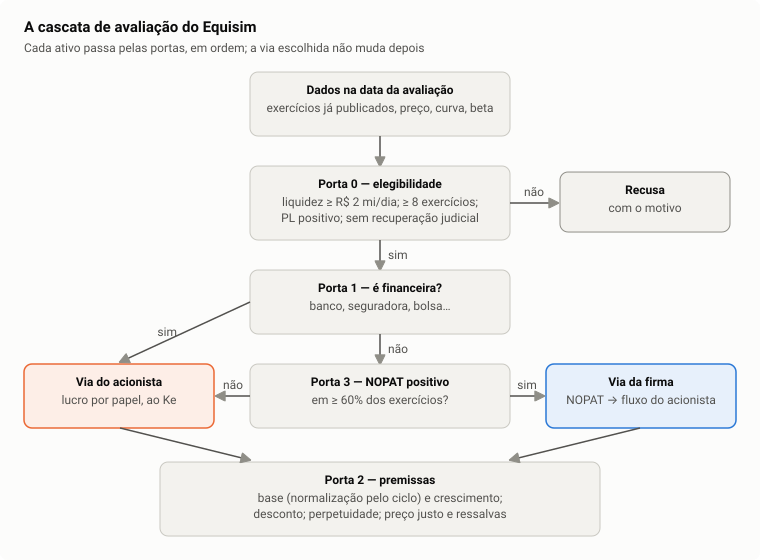

# 2. Cascata e portas

A ordem em que o motor decide se avalia uma empresa e por qual caminho. Estudo:
[guia, cap. 4, seções 4.2 e 4.3](../estudo/04-fluxo-de-caixa-descontado.md).

Tudo acontece em [compute-valuation.ts](../../src/core/usecases/compute-valuation.ts),
a partir de `ValuationCascade.evaluate`.

---

## 2.1 A ordem

| # | Etapa | Função | Recusa quando |
|---:|---|---|---|
| 1 | Concessão que acaba antes do horizonte encurta a projeção | `evaluate` | — |
| 2 | Preço positivo | `evaluate` | preço ≤ 0 |
| 3 | Exercícios publicados na data, com demonstração de resultado | `evaluate` | nenhum exercício |
| 4 | **Porta 0** — elegibilidade | [eligibility.ts](../../src/core/services/valuation/eligibility.ts), `EligibilityGate.assess` | ver 2.2 |
| 5 | Razão da unit e contagem de papéis | `quotedUnitRatio`, `quotedShares` | contagem indisponível |
| 6 | **Portas 1 e 3** — roteamento | `route` | — |
| 7 | **Porta 2** — premissas e desconto na via escolhida | `evaluateLane` | dado não sustenta a via; estrutura de capital recusada; preço justo ≤ 0 |
| 8 | Resultado, cenários, diagnósticos | `conclude`, `withScenarios`, `diagnose` | — |

---

## 2.2 Porta 0 — elegibilidade

| Critério | Parâmetro | Código | Por quê |
|---|---|---|---|
| Liquidez | volume financeiro diário **mediano** dos últimos 90 pregões ≥ R$ 2 milhões (sem volume na série, o teste é omitido) | `minAverageDailyTradedValue`, `liquidityWindowDays`, `medianTradedValue` | preço de papel ilíquido informa pouco e contamina o beta; mediana porque um dia de leilão não faz liquidez |
| Histórico | ≥ 8 exercícios publicados | `minPublishedPeriods` | os testes de ciclo, tendência e crescimento precisam de série |
| Insolvência | patrimônio ≤ 0 (ou ausente) no último **e** no penúltimo exercício | `insolvent` | sem patrimônio não há base de capital |
| Recuperação judicial | lista mantida | [distressed-registry.ts](../../src/data/config/distressed-registry.ts) | o fluxo descontado supõe continuidade |

A recusa por liquidez foi medida contra a ordenação e fica pelo nível do preço
justo, e não pela ordenação: os ilíquidos ordenam, mas o preço justo deles fica
11 p.p. acima do das avaliadas ([recusas_custo.md](../validacao/recusas_custo.md),
[beta_liquidez.md](../validacao/beta_liquidez.md)).

---

## 2.3 Porta 1 — instituição financeira

| Regra | Código | Por quê |
|---|---|---|
| Setor "serviços financeiros" da fonte, ou setor B3 "financeiro" com subsetor intermediários financeiros, previdência e seguros ou serviços financeiros diversos → **via do acionista** | [financial-sectors.ts](../../src/core/services/valuation/financial-sectors.ts), `FinancialSectors.isFinancial` | captação é insumo, não financiamento (Damodaran, "Valuing financial service firms") |

O aviso da tela explica a razão em uma frase.

---

## 2.4 Porta 3 — fluxo operacional sustentado

| Regra | Código | Por quê |
|---|---|---|
| NOPAT (publicado ou derivado) positivo em pelo menos 60% dos exercícios, com pelo menos 4 → **via da firma**; senão, **via do acionista** | [growth-guards.ts](../../src/core/services/valuation/growth-guards.ts), `GrowthGuards.firmFlowIsSustained` | a via da firma projeta o resultado operacional; com ele negativo na maioria dos anos, não há base a projetar; nas coortes, os casos da Porta 3 têm o maior poder de ordenação dos três roteamentos ([porta3.md](../validacao/porta3.md)) |
| A fronteira usa o fluxo, e não a comparação entre retorno e custo de capital do dia | `route` | medir contra a taxa do dia faria a via andar com o ciclo monetário |

---

## 2.5 A via não muda depois de escolhida

| Regra | Código | Evidência |
|---|---|---|
| Se a via escolhida recusa (estrutura de capital, preço justo ≤ 0), o ativo é recusado — não é mandado para a outra via | `evaluateLane` | trocar de modelo porque um recusou faria o preço justo depender de qual conta alcançou um número |
| As duas vias são modelos distintos, não duas opiniões sobre o mesmo número | — | discordavam além de 1,5× em 55 de 92 ativos, e amarrar os insumos fecha só 15,5% da dispersão ([insumos_compartilhados.md](../validacao/insumos_compartilhados.md)) |

Imposições de diagnóstico (`laneOverride`, `growthOverride`, `terminalReturnOverride`
etc.) existem só para medição e testes; o aplicativo não as usa.

---

## 2.6 As recusas, contadas

Na entrada congelada de 14/09/2026 (gabarito, montagem do aplicativo, motor de
03/11/2026, com o ano corrente anualizado), de 379 ativos: 195
recusados por liquidez, 34 por histórico, 3 por patrimônio não positivo; os
outros 26, por estrutura de capital na via da firma (13), por fluxo do
acionista que não sustenta capital próprio positivo (3: ANIM3, CSAN3 e RAPT4),
por dado que não sustenta via (5) ou sem preparo, sem demonstrativo ou sem
cotação (5). **121 avaliados**: 101 pela via da firma, 20 pela do acionista (18
financeiras e duas não financeiras, AZEV4 e HBSA3). O caso de estudo de uma
recusa é o da RAPT4 ([caso RAPT4](../estudo/casos/rapt4.md)).
